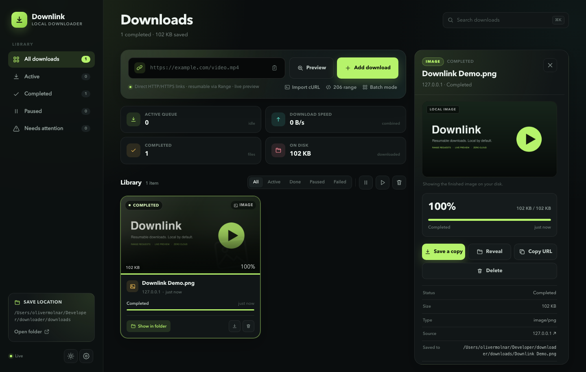

# Downlink

A local-first, resumable media and file downloader built with **pure Bun** — no runtime
dependencies, no framework, and no build step. The web UI is served by `Bun.serve` using
Bun's native HTML imports, the API runs on the same server, and download state lives in
SQLite via `bun:sqlite`.


The detail view includes a range-enabled player, resumable progress, metadata and file actions:



## Features

- **Resumable downloads** with HTTP `Range`, `If-Range`, `ETag` and `Last-Modified`
  validation. Pausing, restarting the server, or a dropped connection keeps the partial
  file and continues from the correct byte.
- **cURL import with live preview** — paste a “Copy as cURL” command and Downlink fills
  the URL, Range, If-Range and request headers (referer, user-agent, authorization,
  cookies, etc.) automatically. The import window previews the parsed request as you type
  or paste, before committing anything. Imported headers are used for inspection, remote
  preview and every subsequent download/resume request.
- **Explicit 206 range downloads** — enter a start/end byte and an optional `If-Range`
  validator. Downlink sends `Range`, requires a `206 Partial Content` response, and saves
  only that segment with a descriptive filename.
- **Live preview** for video, audio and images — including while a file is still
  downloading. The local preview endpoint supports byte ranges, so seeking works as the
  file grows.
- **Inspect before downloading** — probe a remote URL, see its size, type, range support
  and validators, and stream a signed remote preview without committing to a download.
- **Download queue** with a configurable concurrency limit (1–10), queued/paused/completed
  states, retry, cancel and delete.
- **Live progress** over Server-Sent Events: per-file speed, ETA, progress, combined speed,
  and queue counts. No polling.
- **Global speed limit** in MB/s, applied fairly across active downloads.
- **SQLite persistence** for the queue, settings and history. Interrupted jobs are
  recovered automatically after a restart.
- **Filename handling** from `Content-Disposition` (`filename*` included) with safe
  sanitization, extension inference from MIME type, and collision-free `name (1).ext`
  paths.
- **Batch mode** for adding multiple URLs (line-separated) with per-URL results.
- **Browser conveniences**: paste from clipboard, drag-and-drop a link, search, filter,
  keyboard shortcuts (`⌘K` search, `/` search, `n` new URL), dark/light theme, desktop
  notifications, toasts, and OS file-manager reveal.
- **Responsive UI** with no client-side framework. The client is TypeScript bundled by
  Bun's native HTML pipeline, split into feature modules so changes stay localized.
- **Files stay local.** No telemetry, accounts, cloud service or external database.

## Requirements

- [Bun](https://bun.sh) 1.2 or newer (developed against Bun 1.4).
- macOS, Linux or Windows. `Reveal` uses `open`/`explorer`/`xdg-open`.

## Run it

```bash
bun install       # only installs TypeScript dev types
bun run dev       # hot reload on http://127.0.0.1:3000
```

For a normal run:

```bash
bun start
```

The server binds to `127.0.0.1` by default. Downloads are written to `./downloads`, and
the SQLite database lives in `./data/downlink.db`.

### Environment variables

| Variable       | Default                    | Description                                  |
| -------------- | -------------------------- | -------------------------------------------- |
| `PORT`         | `3000`                     | HTTP port.                                   |
| `HOST`         | `127.0.0.1`                | Bind address. Only expose on trusted LANs.   |
| `DOWNLOAD_DIR` | `./downloads`              | Initial save folder (also editable in the UI).|
| `DATA_DIR`     | `./data`                   | Directory for the SQLite database.           |

```bash
PORT=8080 DOWNLOAD_DIR="$HOME/Downloads/Video" bun start
```

## Documentation website

The documentation lives in [`docs-site/`](docs-site) and is built with
[Docusaurus](https://docusaurus.io). It is published alongside the marketing site at
**<https://403access.github.io/downlink/docs/>** and shares the marketing site's design
system (dark panels, lime accent, mono labels, and the same type scale).

```bash
bun run docs:dev     # docs dev server on http://127.0.0.1:4000
bun run docs:build   # build the docs into dist/docs/
bun run docs:serve   # preview the built docs on http://127.0.0.1:4001
```

The docs content is plain Markdown/MDX under `docs-site/docs/`, with the sidebar in
`docs-site/sidebars.ts` and the theme in `docs-site/src/`. The landing page,
navbar, and footer are React components that reuse the marketing site's visual language.

## Marketing website

The product site lives in [`website/`](website) and is published at
**<https://403access.github.io/downlink/>**.

It is a dependency-free static site. GitHub Actions builds it with
[`scripts/build-site.ts`](scripts/build-site.ts) on every relevant push to `main`,
then deploys the resulting `dist/` directory to GitHub Pages. Pull requests touching
the site also run the build, without deploying.

```bash
bun run site:build   # template + minify CSS/JS into dist/, then build docs into dist/docs/
bun run site:dev     # build both and preview on http://127.0.0.1:4173
```

The build injects the repository version and commit, copies the current app
screenshots from the repository root, and generates `sitemap.xml`, `robots.txt`,
`404.html`, and `.nojekyll`. `SITE_URL` overrides the canonical URL used in metadata
and the sitemap; the docs build derives its own base path (`/docs/`) from the same
variable:

```bash
SITE_URL=https://example.com bun run site:build
```

To deploy to a different host, serve the generated `dist/` directory as static files.
No server-side runtime is required.

## Using the app

1. Paste a **direct** HTTP/HTTPS file URL, for example a `.mp4`, `.webm`, `.mp3`,
   `.jpg`, `.zip` or PDF.
2. To preserve a browser request, click **Import cURL** (or paste a cURL command into the
   URL field). URL, Range, If-Range and headers are filled in automatically.
3. Press **Add download**, or **Preview** to inspect and stream the remote file first.
4. For a partial transfer, open **206 range**, enter the starting byte, an optional end
   byte and an optional `If-Range` validator. The download expects `206 Partial Content`
   and saves only the requested segment.
5. While downloading you can pause, resume, preview the partial file, or cancel.
6. Completed cards expose preview, “save a copy”, reveal in Finder/Explorer, and delete.

The **Preview** button and the detail player use `/api/downloads/:id/preview`, which
supports `Range` requests against the `.part` file while a download is in progress. This
works best for MP4 files with metadata at the front; some codecs/containers are not
playable by every browser.

### Importing a browser request

Paste a request copied from DevTools (Network → right-click → Copy → Copy as cURL) into
**Import cURL**, or paste it directly into the URL field. For example:

```bash
curl --url 'https://example.com/video.mp4' \
  -H 'referer: https://example.com/watch' \
  -H 'range: bytes=432144384-823121180' \
  -H 'if-range: "6aa88fff-310fd51d"' \
  -H 'user-agent: Mozilla/5.0'
```

The URL, byte range, `If-Range` validator and headers are filled in automatically.
`Range` and `If-Range` become the 206 controls; all other safe headers are sent on
inspection, preview and download requests, and are stored with the job so pause/resume
continues to work. The import window shows a live parsed request preview while you type,
paste, or change the command.

## API overview

| Method | Route                              | Purpose                              |
| ------ | ---------------------------------- | ------------------------------------ |
| GET    | `/api/health`                      | Engine health and save folder.       |
| GET    | `/api/downloads`                   | Snapshot: jobs, summary, settings.   |
| POST   | `/api/downloads`                   | Add `{ url }` or `{ urls: [] }`; optional `range`, `headers`. |
| POST   | `/api/inspect`                     | Probe a URL and create a preview; accepts `headers`. |
| GET    | `/api/events`                      | SSE stream of job/settings changes.  |
| GET    | `/api/downloads/:id`               | Single job.                          |
| POST   | `/api/downloads/:id/pause`         | Pause (or pause queued job).         |
| POST   | `/api/downloads/:id/resume`        | Resume a paused job.                 |
| POST   | `/api/downloads/:id/retry`         | Retry failed/canceled job.           |
| POST   | `/api/downloads/:id/cancel`        | Cancel and remove partial data.      |
| POST   | `/api/downloads/:id/reveal`        | Reveal file/folder in file manager.  |
| DELETE | `/api/downloads/:id?files=false`   | Remove job; keep files (`files=false`). |
| GET    | `/api/downloads/:id/preview`       | Range-enabled inline preview.        |
| GET    | `/api/downloads/:id/file`          | Range-enabled attachment download.   |
| GET    | `/api/preview/:id`                 | Short alias for preview.             |
| GET    | `/api/files/:id`                   | Short alias for attachment.          |
| GET    | `/api/remote-preview?token=…`      | Signed remote preview proxy.         |
| GET    | `/api/settings`                    | Read settings.                       |
| PATCH  | `/api/settings`                    | Update folder/concurrency/limit.     |
| POST   | `/api/actions/pause-all`           | Pause the queue.                     |
| POST   | `/api/actions/resume-all`          | Resume paused downloads.             |
| POST   | `/api/actions/clear-completed`     | Remove completed records (keep files).|
| POST   | `/api/actions/clear-history`       | Remove failed/canceled records.      |
| POST   | `/api/actions/open-folder`         | Open the save folder.                |

## How resume works

1. A download writes to `<filename>.part` and stores its byte count in SQLite.
2. Pause/cancel/restart leaves the `.part` file in place.
3. On resume, Downlink sends `Range: bytes=<downloaded>-` and, when available,
   `If-Range: <ETag or Last-Modified>`.
4. A `206 Partial Content` response is appended. If the server replies `200` or the
   validator changed, the partial file is truncated and the download restarts from byte 0.
5. When the response ends, the part file is renamed to its final name and the job is
   marked completed.

For an explicit segment, the same mechanism sends `Range: bytes=<start>-<end>` with an
optional `If-Range`. A `200 OK` response is rejected in this mode rather than silently
saving the whole file; the UI displays the observed `206 Partial Content` status, the
requested range and the original remote size.

The fixture tests in `tests/` exercise the range parser, safe filename handling and the
resume behavior against a local range-capable server.

## Development

```bash
bun run dev        # server + client hot reload
bun run typecheck  # tsc --noEmit
bun test           # unit/integration tests
bun run test:e2e   # isolated Chrome CDP pause/resume test
bun run test:curl  # isolated Chrome CDP cURL import + private preview test
bun run test:browser # smoke + screenshots against a running app
```

The CDP scripts use the local Chrome/Chromium installation and write screenshots to
`artifacts/` (ignored by git). Set `CHROME_PATH` if the browser is not in a standard
location, and `APP_URL` for the smoke test.

Project layout:

```text
src/
  client.ts      browser entry (loads ./client/index)
  client/        framework-free UI modules
    index.ts       bindings, drag/drop, boot
    cards.ts       library cards, filters, summaries, thumbnails
    composer.ts    add form, 206 range mode, cURL apply, clipboard paste
    detail.ts      detail dialog and media preview
    inspect.ts     remote inspect dialog
    curl-preview.ts live cURL preview + imported-header chips
    actions.ts     pause/resume/retry/delete actions and confirm dialog
    settings.ts    settings and queue actions
    events.ts      SSE state updates
    dom.ts         shared DOM references/state/toasts
    format.ts      formatting helpers
    types.ts       client-side types
  server.ts      Bun.serve entry and route table
  server/        API helpers split by responsibility
    context.ts     store/engine/config bootstrapping
    add.ts         URL/range/header add pipeline
    files.ts       local file + Range responses
    preview.ts     signed remote-preview token/proxy
    sse.ts         event stream
    http.ts        JSON/error helpers
    snapshot.ts    API snapshot summary
    fs-actions.ts  open/reveal in file manager
  engine.ts      download scheduler and state
  engine/        transfer and error helpers
  probe.ts       HEAD / one-byte Range probing and metadata
  curl.ts        pasted-cURL parser (URL, headers, Range, If-Range)
  headers.ts     request-header normalization and managed-header rules
  db.ts          bun:sqlite schema and persistence
  utils.ts       filename, MIME, range and URL helpers
  index.html     Bun-native fullstack entry
  styles.css     CSS entry point (imports ./css/*)
  css/           split styles by feature
tests/
  utils.test.ts
  engine.test.ts
  probe.test.ts
  curl.test.ts
scripts/browser/
  cdp.ts         shared headless-Chrome / DevTools Protocol helpers
  pause.ts       isolated pause/resume E2E with Range + If-Range assertions
  curl.ts        isolated cURL import, private preview and private download test
  smoke.ts       desktop/mobile/theme screenshots and console-error check
scripts/build-site.ts   marketing site build (templates, minify, sitemap)
scripts/serve-site.ts   local preview server for dist/
website/         marketing site source (static HTML/CSS/JS + assets)
docs-site/       documentation site (Docusaurus, shares the marketing design)
  docs/          Markdown/MDX documentation pages
  src/           custom navbar, footer, landing page, and theme CSS
.github/workflows/marketing-site.yml  builds and deploys both sites to Pages
downloads/       default save folder
data/            SQLite database (created at runtime)
artifacts/       generated browser screenshots (ignored)
```

## Notes and limits

- This is a **direct-file** downloader. HLS/DASH manifests (`.m3u8`, `.mpd`) are detected
  and rejected rather than incorrectly saved as playlists.
- Sites that require cookies, a logged-in session, or a specific `Referer` may return
  401/403. Use **Import cURL** to carry those request headers over; Downlink does not
  bypass authentication or anti-bot protections.
- Imported request headers (including cookies or authorization tokens) are stored in the
  local SQLite database so paused downloads can resume. Do not share the `data/` directory.
- The signed remote preview proxy is intentionally limited to URLs inspected by the
  engine. The server binds to localhost by default; do not expose it to an untrusted
  network.
- Only download content you have permission to save.
- The UI uses browser-native media playback. Unsupported codecs can still be downloaded
  and opened in a local player.
